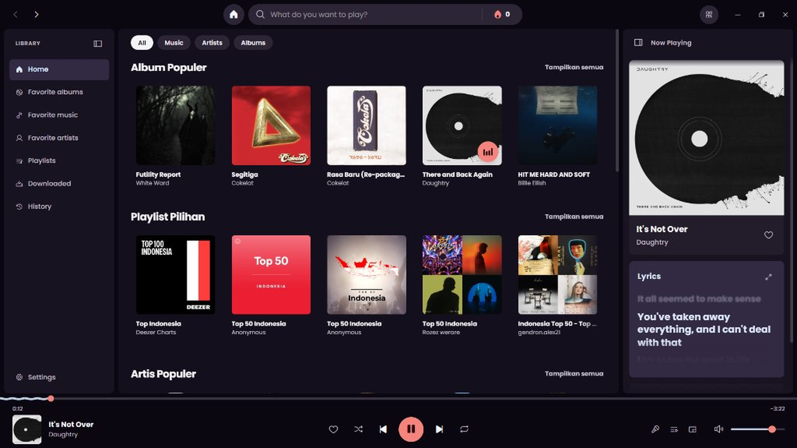
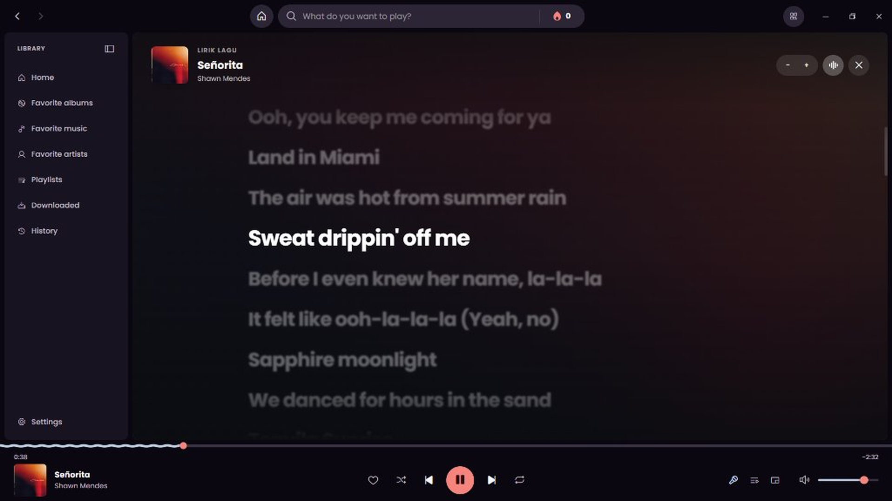
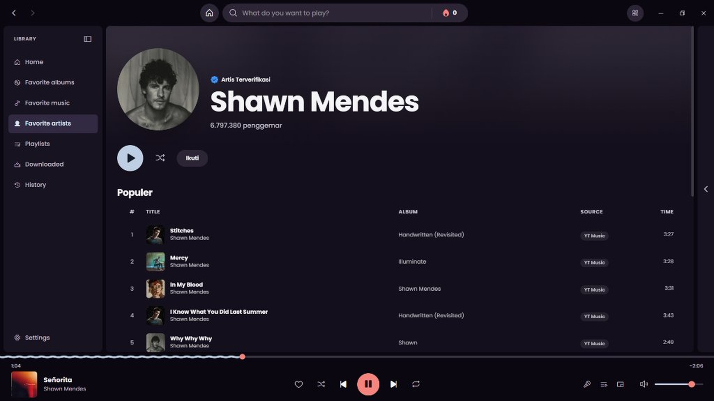
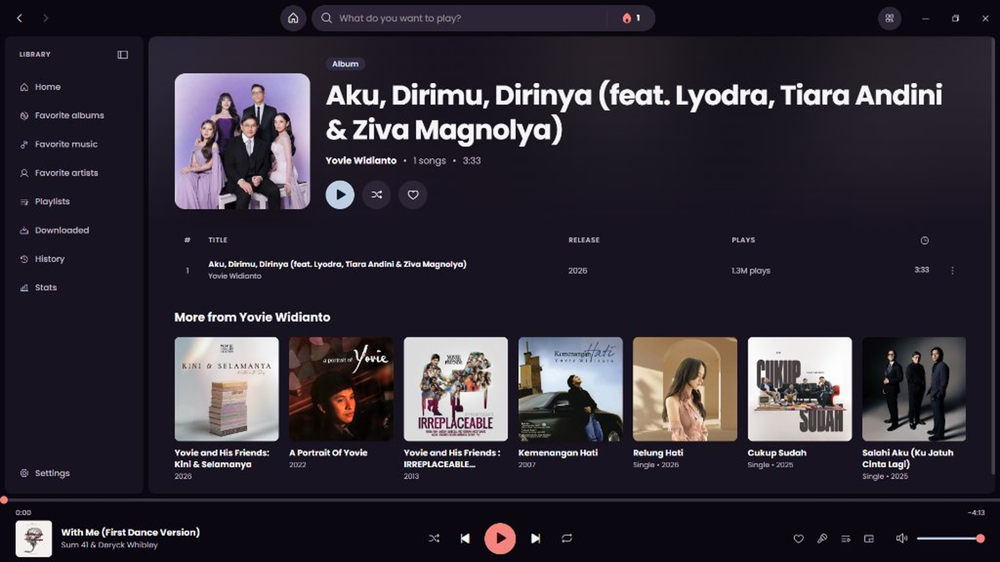
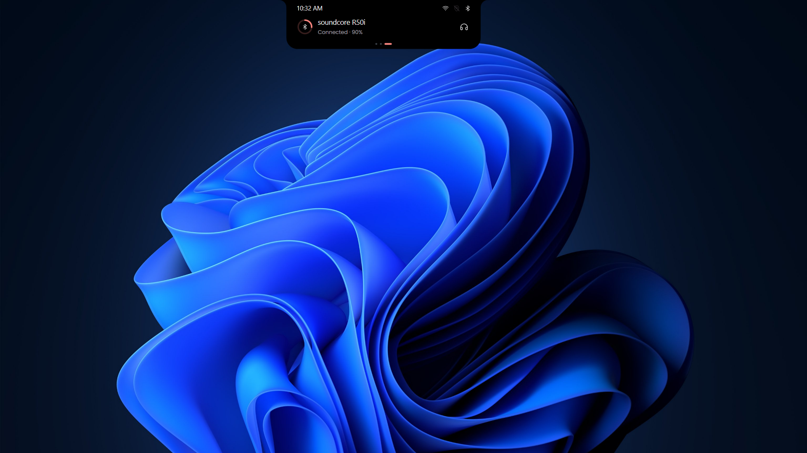
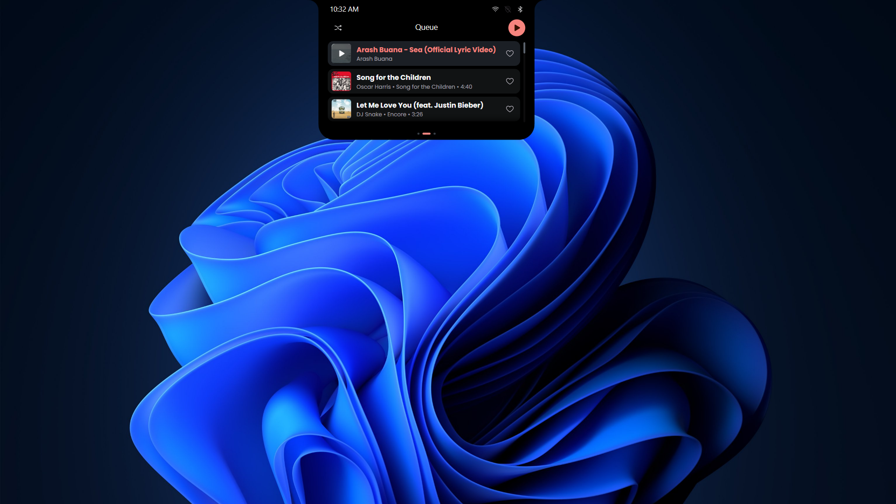

<div align="center">
  

  <h1>Velora</h1>
  <p><strong>Modern Desktop Music Player for Windows with Native Dynamic Island, Synchronized Lyrics, Hybrid Streaming &amp; Velora Jam</strong></p>

  <p>
    <a href="https://apps.microsoft.com/detail/9PN43QQ19SS9"></a>
    <a href="https://github.com/Rafifdev/Velora/releases/tag/v1.2.0"></a>
    
    
    
    
    <a href="LICENSE"></a>
  </p>
</div>

---

## Overview

**Velora** is a native desktop music player for Windows built with **Go (Wails v2)** and **Svelte 5**. It combines online catalog streaming, local library playback, multi-source time-synced lyrics with word-by-word sweep, a mobile-friendly **Velora Jam** Wi-Fi remote, and a native Win32/Direct2D **Dynamic Island** overlay at the top edge of your screen — designed around an adaptive **Material Design 3** interface.

Velora is officially published on the [**Microsoft Store**](https://apps.microsoft.com/detail/9PN43QQ19SS9) under **Velora Player - Dynamic Island**.

---

## Installation

### Microsoft Store (Recommended)
1. Open [**Velora Player - Dynamic Island** on Microsoft Store](https://apps.microsoft.com/detail/9PN43QQ19SS9) (or search for it in the Microsoft Store app on Windows 10 / 11).
2. Click **Get** / **Install** to automatically receive signed builds and updates.

### GitHub Releases (Standalone / Installer / MSIX)
Download the latest release assets from [GitHub Releases](https://github.com/Rafifdev/Velora/releases):
- `Velora-Setup.exe` — Native Win32 Setup & Uninstall Wizard
- `Velora-1.2.0-x64.msix` — Packaged Windows MSIX bundle
- `Velora.exe` — Standalone portable executable

---

## Screenshots

<div align="center">
  
  <p><em>Home Discovery, Curated Playlists, Now Playing Panel &amp; Live Lyrics Preview</em></p>
</div>

<br />

<table>
  <tr>
    <td width="50%" align="center">
      
      <br />
      <sub><b>Immersive Time-Synced Lyrics with Word-by-Word Sweep</b></sub>
    </td>
    <td width="50%" align="center">
      
      <br />
      <sub><b>Verified Artist Profile &amp; Popular Tracks</b></sub>
    </td>
  </tr>
  <tr>
    <td width="50%" align="center">
      
      <br />
      <sub><b>Album Detail View &amp; Artist Releases</b></sub>
    </td>
    <td width="50%" align="center">
      
      <br />
      <sub><b>Native Windows Dynamic Island — Now Playing &amp; Seekbar</b></sub>
    </td>
  </tr>
  <tr>
    <td width="50%" align="center">
      
      <br />
      <sub><b>Dynamic Island — Live Time-Synced Lyrics &amp; Word Sweep</b></sub>
    </td>
    <td width="50%" align="center">
      
      <br />
      <sub><b>Dynamic Island — Queue &amp; Windows Audio Output Switcher</b></sub>
    </td>
  </tr>
</table>

---

## Key Features

### 1. Hybrid Catalog & Local Library Playback
- **Online Streaming & Discovery**: Browse and stream tracks, albums, artists, top charts, and curated playlists powered by YouTube Music (InnerTube) and Deezer metadata enrichment.
- **Content Region & Filtering**: Configure content region (up to 3 countries), default search filter (`Song`, `Album`, `Artist`, `Playlist`, `Video`), and explicit content filtering.
- **Local Audio Library**: Play and index local audio files (`MP3`, `FLAC`, `WAV`, `M4A`, `AAC`, `OGG`, `OPUS`) with metadata tag extraction and embedded artwork support.
- **Offline Downloads**: Download tracks for offline listening with real-time progress tracking and animated download indicators.
- **Playlist Management**: Create, reorder, and customize playlists, import/export `.M3U` files, or import public **Spotify playlists** directly via URL.

### 2. Native Windows Dynamic Island
- **Zero-Overhead Win32 Layered Window**: Rendered directly via Win32 GDI+ and **Direct2D / DirectWrite ClearType** for crisp typography and smooth 60+ FPS liquid transitions.
- **Interactive Multi-Page Overlay**:
  - **Now Playing**: Artwork, scrolling track title/artist, quick favorite toggle, seekbar, and transport controls.
  - **Live Lyrics**: Time-synced scrolling lyrics with optional word-by-word left-to-right sweep right inside the top-edge overlay.
  - **Queue Manager**: Inspect and jump between upcoming tracks in your queue.
  - **Audio Output Switcher**: View active audio hardware, Bluetooth battery status, and switch Windows audio output endpoints on the fly.
- **Full Customization**: Choose between *Dynamic Island*, *Single-Line*, or *Hidden* display modes, adjust width/height/opacity, toggle individual content elements, and pick progress bar styles (*Thin*, *Thick*, *Dots*, or *Animated Wave*).

### 3. Audio Engine & Mastering DSP
- **5-Band Mastering Equalizer**: Built-in presets (*Flat*, *Studio*, *Bass Boost*, *Vocal*, *Treble*, *Warm*, *Rock*, *Pop*, *Electronic*) plus custom dB adjustments.
- **Loudness Normalization & Headroom Protection**: Transparent `-14 LUFS` headroom leveling, sub-sonic DC filter, and true-peak safety limiting to prevent digital clipping.
- **Seamless Transitions**: Configurable crossfade (`0–12s`), playback speed (`0.5x–2.0x`), pitch preservation, and silence trimming.

### 4. Multi-Source Synchronized Lyrics
- **5-Tier Lyrics Resolver**: Automatically queries **LRCLIB** (exact & fuzzy duration match), **NetEase Cloud Music**, **KuGou Music**, **YouTube Music** official lyrics tab, and **Lyrics.ovh** fallback.
- **Immersive Presentation**: Dedicated full-screen and side-panel lyrics views with optional constant-velocity word-by-word karaoke sweep, inactive line blur, per-track offset tuning, and cover-matched ambient backdrops.

### 5. Velora Jam (Mobile Wi-Fi Remote) & Analytics
- **Velora Jam (Wi-Fi Remote)**: Local Wi-Fi remote server with instant QR code pairing and a full mobile-optimized UI featuring a floating mini-player, smooth animated Now Playing view with music recommendations, draggable Queue & Audio Output bottom sheets (`70%`/`90%` snap), mobile Library, Playlists, and real-time Downloads view.
- **Listening Analytics & Fire Streak**: Track daily listening goals, active listening streaks, top tracks/artists, and listening history with configurable auto-prune intervals.

---

## Tech Stack

| Layer | Technology |
| :--- | :--- |
| **Desktop Framework** | [Wails v2](https://wails.io/) (Go + WebView2) |
| **Backend** | Go 1.24, SQLite (`modernc.org/sqlite`, WAL mode), Native Win32 / Direct2D / DirectWrite / Windows Core Audio COM |
| **Frontend** | Svelte 5 (Runes), TypeScript, Tailwind CSS v4, Material Design 3 Tokens |
| **Audio Pipeline** | Web Audio API Mastering Graph + Local HTTP Range Stream Proxy & MPV IPC Bridge |
| **Packaging** | Custom zero-dependency native Win32 Setup Wizard (`cmd/installer`) & Windows MSIX (`scripts/build_msix.ps1`) |

---

## Getting Started

### Prerequisites
- **Windows 10 / 11 (64-bit)** with Microsoft Edge WebView2 Runtime
- **Go 1.24+**
- **Node.js 20+** & **npm**
- **Wails CLI v2.11+** (`go install github.com/wailsapp/wails/v2/cmd/wails@latest`)

### Development

```powershell
# 1. Install frontend dependencies
npm --prefix frontend install

# 2. Run type and Svelte diagnostics
npm --prefix frontend run check

# 3. Start Wails in live development mode
wails dev
```

### Building Production Binary, Installer & MSIX

```powershell
# Build standalone application binary (build/bin/Velora.exe)
wails build -clean

# Build the native Win32 Setup Wizard (build/bin/Velora-Setup.exe)
powershell -ExecutionPolicy Bypass -File scripts/build_installer.ps1

# Build the Windows MSIX package for Microsoft Store (build/bin/Velora-1.2.0-x64.msix)
powershell -ExecutionPolicy Bypass -File scripts/build_msix.ps1 -Version 1.2.0.0
```

---

## Project Structure

```text
velora/
├── app.go                              # Wails application lifecycle & frontend bindings
├── dynamic_island_windows.go           # Native Win32 GDI+ Dynamic Island overlay
├── dynamic_island_dwrite_windows.go    # Direct2D & DirectWrite ClearType text renderer
├── audio_devices_windows.go            # Windows Core Audio endpoint enumeration & switching
├── taskbar_windows.go                  # Windows taskbar thumbnail toolbar controls
├── cmd/installer/                      # Native Win32 Setup & Uninstall Wizard
├── scripts/
│   ├── build_installer.ps1             # Build Velora-Setup.exe installer
│   └── build_msix.ps1                  # Package Velora MSIX for Microsoft Store
├── internal/
│   ├── audio/                          # Audio stream proxy, transcode & MPV IPC controller
│   ├── db/                             # SQLite schema, migrations, and repository methods
│   ├── jam/                            # Velora Jam Wi-Fi remote HTTP/SSE server & mobile UI
│   ├── sources/                        # YouTube Music, Deezer, Spotify, LRCLIB & local scanner
│   ├── stats/                          # Listening stats & Fire Streak calculation service
│   └── tray/                           # Windows System Tray controller
└── frontend/
    └── src/
        ├── components/                 # Reusable M3 UI components (CoverImage, MobileNowPlaying, MobileQueueSheet, etc.)
        ├── views/                      # Main views (Home, MobileLibrary, MobileDownloads, Playlists, Settings)
        └── lib/                        # API bridge, Web Audio DSP engine, i18n, and preference definitions
```

---

## Keyboard Shortcuts

| Shortcut | Action |
| :--- | :--- |
| `Space` | Play / Pause current track |
| `←` / `→` | Seek backward / forward 5 seconds |
| `↑` / `↓` | Increase / Decrease volume by 5% |
| `Ctrl` + `+` / `-` | Zoom interface in / out (`70%` – `130%`) |
| `Ctrl` + `0` | Reset interface zoom to `100%` |
| `Tab` | Focus global search bar |

---

## Privacy & License

- Read our [Privacy Policy](PRIVACY_POLICY.md) to see how Velora handles local storage and network connections.
- This project is licensed under the [MIT License](LICENSE).

---

## Author

Developed by **Yoapipp** ([@Rafifdev](https://github.com/Rafifdev)) · [Instagram](https://www.instagram.com/yoapipp/)
