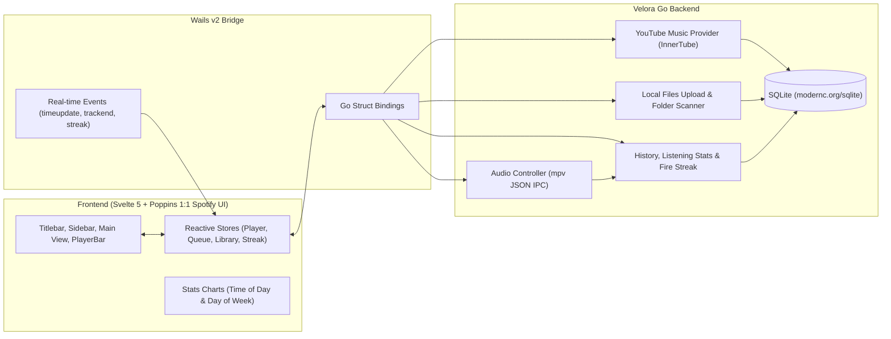

# Implementation Plan: Velora (Lightweight Go + Wails Desktop Music Player)

## Goal Description
Membangun **Velora**, aplikasi desktop music player alternatif Spotify yang ringan dan berukuran kecil menggunakan **Go + Wails v2** dengan antarmuka **1:1 ala Spotify** menggunakan font **Poppins**. Velora mendukung sumber musik dari **YouTube Music** dan **Upload / Import Local Files** untuk seluruh format audio populer (`MP3`, `FLAC`, `M4A/AAC`, `OPUS`, `OGG`, `WAV`, `ALAC`, `WebM`), dilengkapi library lengkap (Home, Favorite Albums/Tracks/Artists, Playlist, Local Playlist, History), **Listening Stats** (jam & hari), serta **Fire Streak** harian.

---

## User Review Required

> [!IMPORTANT]
> **Prasyarat Lingkungan (Go & Wails Belum Terdeteksi di PATH)**
> Saat pengecekan sistem, `node v26.13.1` dan `npm 11.7.0` sudah tersedia, namun `go` dan `wails` belum ditemukan di `PATH`.
> Saat kamu menyetujui plan ini, langkah pertama eksekusi adalah memasang **Go (>= 1.22)** (misal via `winget install GoLang.Go`) dan **Wails CLI v2** (`go install github.com/wailsapp/wails/v2/cmd/wails@latest`).

> [!NOTE]
> **Lokasi Proyek**
> Proyek **Velora** akan dibuat di `C:\Users\MyBook Hype AMD\.gemini\antigravity\scratch\velora`.

---

## Tech Stack & Architecture

| Layer | Teknologi / Library | Alasan Pemilihan |
| :--- | :--- | :--- |
| **Desktop Runtime** | **Wails v2** (Go + WebView2) | Menggunakan WebView2 bawaan Windows (tanpa membundel Chromium), menjaga ukuran app tetap kecil. |
| **Backend Language** | **Go 1.22+** | Cepat, ringan, dan ideal untuk menangani konkurensi streaming, indexing lokal, dan bridge event. |
| **Audio Engine** | **mpv (JSON IPC Controller di Go)** | Mendukung **semua format audio populer** (`MP3`, `FLAC`, `M4A/AAC`, `OPUS`, `OGG`, `WAV`, `WebM`) serta HTTP streaming + seeking instan untuk YouTube Music tanpa CGO/GCC complexity. |
| **YouTube Music Source** | **Pure Go InnerTube Client** (+ fallback `yt-dlp` opsional) | Mencari lagu/artis/album, mengambil stream URL audio, dan metadata langsung dari YouTube Music API dengan footprint minimal. |
| **Metadata & Art** | `github.com/dhowden/tag` | Ekstraksi cepat tag ID3/FLAC/MP4 dan embedded cover art dari file lokal yang di-upload/import. |
| **Database** | `modernc.org/sqlite` | Pure Go SQLite (zero-CGO) untuk indexing lagu, playlist, history, listening stats, dan fire streak. |
| **Frontend UI** | **Svelte 5 + TypeScript + Vite** | Performa tinggi, bundle sangat kecil, animasi & seekbar 60fps. |
| **Styling & Icons** | **Tailwind CSS v4** + `lucide-svelte` | Desain presisi 1:1 ala Spotify dengan ikon modern yang tajam. |
| **Typography** | `@fontsource/poppins` | Self-hosted **Poppins** (400, 500, 600, 700) agar tampil konsisten meski offline. |

### System Architecture Diagram



---

## Proposed Changes

Struktur proyek akan dibuat di `C:\Users\MyBook Hype AMD\.gemini\antigravity\scratch\velora`:

### 1. Project Foundation & Wails Configuration
#### [NEW] `go.mod`, `wails.json`, `main.go`, `app.go`
- Konfigurasi aplikasi **Velora** dengan `Frameless: true` untuk custom Spotify-style window header.
- Inisialisasi folder data di `%AppData%/Velora/` (`velora.db`, `uploads/` untuk file lokal yang di-upload, dan `artwork_cache/`).
- Registrasi Go services ke Wails context.

---

### 2. Database Schema (`internal/db/`)
#### [NEW] `internal/db/schema.sql` & `internal/db/sqlite.go`
Tabel SQLite untuk seluruh 12 fitur:
- `sources`: `(id, name, type ['ytmusic'|'local_folder'|'local_upload'], config_json, enabled, last_synced_at)`
- `artists`, `albums`, `tracks`: Menyimpan lagu dari YouTube Music (`source_type = 'ytmusic'`, `external_id = videoId`) dan Local Files (`source_type = 'local'`, `file_path`), lengkap dengan durasi, format, artwork, dan `is_favorite`.
- `playlists` & `playlist_tracks`: Mendukung **Playlist** (termasuk playlist YouTube Music / umum) dan **Local Playlist** (`is_local = 1`) dengan urutan lagu custom.
- `play_history`: `(id, track_id, played_at, duration_listened_sec, completed)` untuk **History** dan **Listening Stats**.
- `daily_streaks`: `(date_str PRIMARY KEY, seconds_listened, tracks_count, streak_met)` untuk **Fire Streak**.
- `preferences`: Pengaturan audio, kualitas stream YouTube Music, target menit harian streak, accent color, dan storage.

---

### 3. Audio Engine & Music Sources (`internal/audio/` & `internal/sources/`)
#### [NEW] `internal/audio/mpv_player.go`
- Mengontrol `mpv` secara headless via Windows Named Pipe / JSON IPC (`--no-video --idle --input-ipc-server=...`).
- Mendukung `Play`, `Pause`, `Resume`, `Seek`, `Volume`, `Mute`, `Next`, `Prev`, `Shuffle`, `Repeat (off|all|one)`, serta `Gapless` playback.
- Jika lagu berasal dari YouTube Music, stream URL di-resolve secara lazy tepat sebelum diputar (dan di-cache sementara selama masa berlaku URL) sehingga hemat memori.
- Otomatis memicu pencatatan ke `StatsService` saat durasi dengar melewati ambang batas (mis. >= 30 detik).

#### [NEW] `internal/sources/ytmusic.go`
- Integrasi **YouTube Music (InnerTube API)**:
  - Search lagu, album, artis, dan playlist.
  - Fetch rekomendasi Home / Quick Picks / Charts.
  - Ekstraksi stream audio (prioritas `Opus` / `M4A` kualitas terbaik sesuai Preferences).
  - Fallback otomatis ke `yt-dlp` jika diperlukan.

#### [NEW] `internal/sources/local.go`
- **Upload Local Files**: Mendukung pilih multi-file (native file dialog atau drag-and-drop di UI) untuk di-copy/import ke library Velora, serta **Add Local Folder** untuk scan folder musik di PC.
- Mendukung format: `.mp3`, `.flac`, `.m4a`, `.aac`, `.ogg`, `.opus`, `.wav`, `.wma`, `.webm`.
- Ekstraksi tag ID3/FLAC/MP4 dan embedded cover art dengan `dhowden/tag`.

---

### 4. Analytics: Listening Stats & Fire Streak (`internal/stats/`)
#### [NEW] `internal/stats/service.go`
- **Listening Stats**:
  - `Time of Day`: Agregasi menit & jumlah putar per jam (`00:00` – `23:00`).
  - `Day of Week`: Agregasi Senin – Minggu + insight waktu puncak mendengarkan.
- **Fire Streak**:
  - Menghitung `currentStreak`, `longestStreak`, progres hari ini vs target harian (default: 10 menit atau 3 lagu/hari, dapat diubah di Preferences), serta kalender streak 30 hari terakhir.

---

### 5. Frontend: 1:1 Spotify UI + Font Poppins (`frontend/src/`)
#### [NEW] `frontend/src/app.css` & `frontend/src/components/layout/`
- Font **Poppins** (`@fontsource/poppins`) diterapkan secara global dengan `tabular-nums` untuk durasi & statistik.
- **Titlebar**: Navigasi `<` `>`, Search bar global (mencari ke Local + YouTube Music), **Fire Streak 🔥 badge** interaktif, dan tombol window controls.
- **Sidebar**: Menu (**Home**, **History**, **Listening Stats**, **Sources**, **Preferences**) + panel **Your Library** dengan filter chips (*Playlists*, *Local Playlists*, *Favorite Tracks*, *Favorite Albums*, *Favorite Artists*).
- **PlayerBar**: 1:1 Spotify bottom bar (Cover + Judul + Artis + ❤️ | Shuffle, Prev, Play/Pause, Next, Repeat + Seekbar | Queue, Volume, Mini-player).

#### [NEW] 12 Fitur Views (`frontend/src/views/`)
1. **Home**: Greeting dinamis + Fire Streak ringkas, Quick-Access Grid, Shelf **Playlists**, dan daftar **All Songs** (gabungan Local + YouTube Music).
2. **Favorite Albums**: Grid album favorit dengan adaptive hover play button.
3. **Favorite Tracks**: Halaman "Liked Songs" bergradien ungu khas Spotify dengan filter & instant play.
4. **Favorite Artists**: Grid avatar artis bulat + halaman detail artis.
5. **Playlist**: Playlist umum & playlist dari YouTube Music.
6. **Local Playlist**: Playlist khusus lokal (buat, rename, drag-and-drop reorder, export/import `.m3u`).
7. **History**: Riwayat pemutaran lagu lengkap dengan timestamp relatif.
8. **Sources**: Panel untuk **Upload Local Files** (drag & drop / file picker), kelola folder lokal, dan status koneksi **YouTube Music**.
9. **Preferences**: Pengaturan audio, kualitas stream YouTube Music, target Fire Streak harian, tema/accent color, dan manajemen cache.
10. **Listening Stats**: Grafik **Time of Day** (24 jam) & **Day of Week** (Senin–Minggu) dengan desain clean SVG.
11. **Fire Streak**: Modal/halaman detail runtutan api harian, rekor terpanjang, dan kalender harian.
12. **UI 1:1 Spotify + Poppins**: Konsistensi spacing, dark palette (`#000000`, `#121212`, `#181818`, `#1DB954`), dan adaptive header gradient.

---

## Verification Plan

### Automated Tests
1. **Go Unit Tests (`go test ./...`)**:
   - Pengujian logika **Fire Streak** (streak aktif, streak putus, target harian tercapai).
   - Pengujian agregasi **Listening Stats** (Time of Day & Day of Week).
   - Pengujian CRUD SQLite untuk **Local Playlist**, **Favorites**, **History**, dan **Local File Scanner**.
2. **Frontend Type Check & Build**:
   ```powershell
   cd frontend; npm run check; npm run build
   ```
3. **Wails Build Check**:
   ```powershell
   wails build
   ```

### Manual Verification
1. Jalankan `velora.exe` hasil build.
2. Buka **Sources** -> coba **Upload Local Files** (MP3, FLAC, M4A, OPUS, WAV) dan cari lagu dari **YouTube Music**.
3. Verifikasi pemutaran lagu (Play, Pause, Seek, Next, Prev, Volume, Shuffle, Repeat) di **PlayerBar**.
4. Uji **Favorite Tracks / Albums / Artists**, **Playlist**, **Local Playlist**, dan **History**.
5. Verifikasi **Fire Streak 🔥** menyala setelah target tercapai dan grafik **Listening Stats** (Time of Day & Day of Week) ter-update.
6. Verifikasi layout **1:1 Spotify** menggunakan font **Poppins** di seluruh tampilan.
